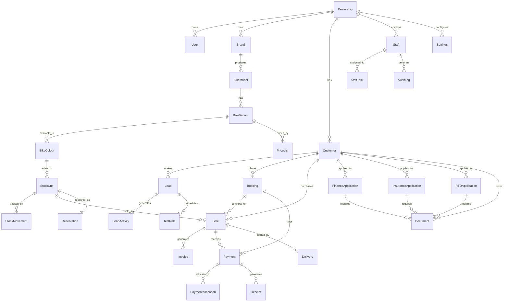

# DATABASE.md — The Bike Yard

**Product:** The Bike Yard — Complete Dealership Management & Digital Showroom Platform  
**Status:** Draft — Pending Dealership Owner Review  
**Version:** 1.0  
**Source of Truth:** Yes — Follows PRD.md, DESIGN.md, ARCHITECTURE.md  
**Previous Documents:** PRD.md, DESIGN.md, ARCHITECTURE.md  
**Next Document:** API.md (Prompt 05)

---

## 1. Design Principles

- One central PostgreSQL database; single source of truth.
- Every physical motorcycle is a unique unit; chassis number and engine number uniquely constrained.
- Catalogue records (brand/model/variant) are distinct from physical stock units.
- Immutable price/tax snapshots on issued invoices and completed sales.
- Money stored as integer paise (BIGINT); no floating-point for currency.
- Timestamps stored in UTC; rendered in Asia/Kolkata.
- Soft deletes with `deletedAt`; no hard deletes for business entities.
- All financial/stock mutations in transactions.

---

## 2. Entity Relationship Diagram (Mermaid)

---

## 3. Data Dictionary

### 3.1 Core / Tenancy

**dealership**
| Field | Type | Null | Default | Description |
|-------|------|------|---------|-------------|
| id | UUID | NO | gen_random_uuid() | PK |
| name | String | NO | | Dealership legal name |
| address | String | NO | | Physical address |
| city | String | NO | | Thane |
| state | String | NO | | Maharashtra |
| pincode | String | NO | | |
| phone | String | NO | | |
| email | String | YES | | |
| gstin | String | YES | | GST registration number |
| currency | String | NO | 'INR' | |
| timezone | String | NO | 'Asia/Kolkata' | |
| dateFormat | String | NO | 'DD/MM/YYYY' | |
| createdAt | DateTime | NO | now() | UTC |
| updatedAt | DateTime | NO | now() | UTC |
| deletedAt | DateTime | YES | | Soft delete |

**settings** (appearance + business config, one per dealership)
| Field | Type | Null | Default | Description |
|-------|------|------|---------|-------------|
| id | UUID | NO | gen_random_uuid() | PK |
| dealershipId | UUID | NO | FK dealership |
| theme | String | NO | 'light' | light/dark/system |
| primaryColour | String | NO | '#111827' | |
| secondaryColour | String | NO | '#6366f1' | |
| fontFamily | String | NO | 'Inter' | |
| fontSize | String | NO | 'medium' | small/medium/large |
| sidebarMode | String | NO | 'expanded' | expanded/collapsed |
| invoicePrefix | String | NO | 'TBY' | |
| invoiceNumberSequence | Int | NO | 1 | |
| gstRateDefault | Int | NO | 0 | default GST rate in paise-per-unit (e.g. 2800 = 28%) |
| logoUrl | String | YES | | Storage reference |
| faviconUrl | String | YES | | Storage reference |
| notificationsEmail | Bool | NO | false | |
| notificationsInApp | Bool | NO | true | |
| language | String | NO | 'en' | |
| createdAt | DateTime | NO | now() | |
| updatedAt | DateTime | NO | now() | |

---

### 3.2 Users, Roles, Permissions

**role**
| Field | Type | Null | Default |
|-------|------|------|---------|
| id | UUID | NO | gen_random_uuid() |
| name | String | NO | unique (e.g. 'Super Admin') |
| description | String | YES | |
| dealershipId | UUID | NO | FK |
| createdAt | DateTime | NO | now() |

**permission**
| Field | Type | Null | Default |
|-------|------|------|---------|
| id | UUID | NO | gen_random_uuid() |
| code | String | NO | unique (e.g. 'stock.inward') |
| module | String | NO | |
| description | String | YES | |

**rolePermission** (junction)
| Field | Type | Null |
|-------|------|------|
| roleId | UUID | NO |
| permissionId | UUID | NO |

**user**
| Field | Type | Null | Default |
|-------|------|------|---------|
| id | UUID | NO | gen_random_uuid() |
| email | String | NO | unique |
| passwordHash | String | NO | |
| firstName | String | NO | |
| lastName | String | NO | |
| phone | String | YES | |
| roleId | UUID | NO | FK |
| dealershipId | UUID | NO | FK |
| isActive | Bool | NO | true |
| lastLoginAt | DateTime | YES | |
| createdAt | DateTime | NO | now() |
| updatedAt | DateTime | NO | now() |
| deletedAt | DateTime | YES | |

**session**
| Field | Type | Null | Default |
|-------|------|------|---------|
| id | UUID | NO | gen_random_uuid() |
| userId | UUID | NO | FK |
| expiresAt | DateTime | NO | |
| revokedAt | DateTime | YES | |
| createdAt | DateTime | NO | now() |

**auditLog**
| Field | Type | Null | Default |
|-------|------|------|---------|
| id | UUID | NO | gen_random_uuid() |
| userId | UUID | YES | FK |
| action | String | NO | |
| entityType | String | NO | |
| entityId | UUID | YES | |
| oldValues | Json | YES | |
| newValues | Json | YES | |
| ipAddress | String | YES | |
| createdAt | DateTime | NO | now() |

---

### 3.3 Bike Catalogue

**brand**
| Field | Type | Null | Default |
|-------|------|------|---------|
| id | UUID | NO | gen_random_uuid() |
| name | String | NO | unique per dealership |
| slug | String | NO | unique |
| dealershipId | UUID | NO | FK |
| isActive | Bool | NO | true |
| createdAt | DateTime | NO | now() |

**bikeModel**
| Field | Type | Null | Default |
|-------|------|------|---------|
| id | UUID | NO | gen_random_uuid() |
| brandId | UUID | NO | FK |
| name | String | NO | |
| slug | String | NO | |
| isActive | Bool | NO | true |
| createdAt | DateTime | NO | now() |

**bikeVariant**
| Field | Type | Null | Default |
|-------|------|------|---------|
| id | UUID | NO | gen_random_uuid() |
| modelId | UUID | NO | FK |
| name | String | NO | (e.g. 'Standard', 'Deluxe') |
| engineCC | Int | NO | |
| mileage | String | YES | |
| specifications | Json | YES | |
| isActive | Bool | NO | true |
| createdAt | DateTime | NO | now() |

**bikeColour**
| Field | Type | Null | Default |
|-------|------|------|---------|
| id | UUID | NO | gen_random_uuid() |
| variantId | UUID | NO | FK |
| name | String | NO | |
| code | String | YES | (hex) |
| imageUrl | String | YES | |
| isActive | Bool | NO | true |

**priceList**
| Field | Type | Null | Default |
|-------|------|------|---------|
| id | UUID | NO | gen_random_uuid() |
| variantId | UUID | NO | FK |
| colourId | UUID | YES | FK |
| exShowroomPrice | BigInt | NO | | paise |
| insurancePrice | BigInt | NO | | paise |
| rtoCharges | BigInt | NO | | paise |
| accessoriesPrice | BigInt | NO | | paise |
| discount | BigInt | NO | 0 | paise |
| onRoadPrice | BigInt | NO | | paise (computed snapshot) |
| finalSellingPrice | BigInt | NO | | paise |
| effectiveFrom | DateTime | NO | now() |
| effectiveTo | DateTime | YES | |
| isActive | Bool | NO | true |

---

### 3.4 Inventory & Stock

**stockUnit** (one row per physical motorcycle)
| Field | Type | Null | Default | Description |
|-------|------|------|---------|-------------|
| id | UUID | NO | gen_random_uuid() | PK |
| chassisNumber | String | NO | unique | |
| engineNumber | String | NO | unique | |
| variantId | UUID | NO | FK |
| colourId | UUID | NO | FK |
| purchasePrice | BigInt | NO | | paise |
| purchaseInvoiceNumber | String | YES | |
| supplierName | String | YES | |
| receivedDate | DateTime | NO | |
| status | String | NO | 'available' | available/reserved/sold/delivered |
| dealershipId | UUID | NO | FK |
| createdAt | DateTime | NO | now() |
| updatedAt | DateTime | NO | now() |
| deletedAt | DateTime | YES | |

**stockMovement**
| Field | Type | Null | Default |
|-------|------|------|---------|
| id | UUID | NO | gen_random_uuid() |
| stockUnitId | UUID | NO | FK |
| type | String | NO | inward/outward/reservation/release |
| quantity | Int | NO | 1 |
| referenceType | String | YES | sale/booking/inward |
| referenceId | UUID | YES | |
| notes | String | YES | |
| createdAt | DateTime | NO | now() |
| createdBy | UUID | YES | FK user |

**reservation**
| Field | Type | Null | Default |
|-------|------|------|---------|
| id | UUID | NO | gen_random_uuid() |
| stockUnitId | UUID | NO | FK unique (one reservation per unit) |
| customerId | UUID | NO | FK |
| bookingId | UUID | YES | FK |
| reservedAt | DateTime | NO | now() |
| expiresAt | DateTime | YES | |
| releasedAt | DateTime | YES | |
| status | String | NO | active/released/expired/converted |

---

### 3.5 Customers, Leads, Bookings, Sales

**customer**
| Field | Type | Null | Default |
|-------|------|------|---------|
| id | UUID | NO | gen_random_uuid() |
| dealershipId | UUID | NO | FK |
| firstName | String | NO | |
| lastName | String | NO | |
| phone | String | NO | |
| email | String | YES | |
| address | String | YES | |
| city | String | YES | |
| state | String | YES | |
| pincode | String | YES | |
| gstin | String | YES | |
| idDocumentType | String | YES | |
| idDocumentNumber | String | YES | |
| createdAt | DateTime | NO | now() |
| updatedAt | DateTime | NO | now() |
| deletedAt | DateTime | YES | |

**lead**
| Field | Type | Null | Default |
|-------|------|------|---------|
| id | UUID | NO | gen_random_uuid() |
| customerId | UUID | NO | FK |
| staffId | UUID | YES | FK (assigned sales executive) |
| variantId | UUID | YES | FK |
| colourId | UUID | YES | FK |
| source | String | YES | walkin/website/chatbot/referral |
| status | String | NO | new | new/contacted/qualified/lost/converted |
| estimatedBudget | BigInt | YES | paise |
| notes | String | YES | |
| createdAt | DateTime | NO | now() |
| updatedAt | DateTime | NO | now() |

**leadActivity**
| Field | Type | Null | Default |
|-------|------|------|---------|
| id | UUID | NO | gen_random_uuid() |
| leadId | UUID | NO | FK |
| staffId | UUID | NO | FK |
| type | String | NO | call/meeting/visit/followup |
| notes | String | YES | |
| nextFollowUpAt | DateTime | YES | |
| createdAt | DateTime | NO | now() |

**testRide**
| Field | Type | Null | Default |
|-------|------|------|---------|
| id | UUID | NO | gen_random_uuid() |
| leadId | UUID | NO | FK |
| stockUnitId | UUID | YES | FK |
| staffId | UUID | NO | FK |
| scheduledAt | DateTime | NO | |
| status | String | NO | scheduled | scheduled/completed/cancelled/no-show |
| feedback | String | YES | |
| createdAt | DateTime | NO | now() |

**booking**
| Field | Type | Null | Default |
|-------|------|------|---------|
| id | UUID | NO | gen_random_uuid() |
| bookingNumber | String | NO | unique |
| customerId | UUID | NO | FK |
| stockUnitId | UUID | NO | FK |
| staffId | UUID | YES | FK |
| variantId | UUID | NO | FK |
| colourId | UUID | NO | FK |
| exShowroomPrice | BigInt | NO | paise (snapshot) |
| onRoadPrice | BigInt | NO | paise (snapshot) |
| advanceAmount | BigInt | NO | 0 paise |
| status | String | NO | pending | pending/confirmed/cancelled/delivered |
| bookingDate | DateTime | NO | now() |
| expectedDeliveryDate | DateTime | YES | |
| actualDeliveryDate | DateTime | YES | |
| createdAt | DateTime | NO | now() |
| updatedAt | DateTime | NO | now() |

**sale**
| Field | Type | Null | Default |
|-------|------|------|---------|
| id | UUID | NO | gen_random_uuid() |
| saleNumber | String | NO | unique |
| bookingId | UUID | YES | FK |
| customerId | UUID | NO | FK |
| stockUnitId | UUID | NO | FK |
| staffId | UUID | YES | FK |
| exShowroomPrice | BigInt | NO | paise (snapshot) |
| insurancePrice | BigInt | NO | paise (snapshot) |
| rtoCharges | BigInt | NO | paise (snapshot) |
| accessoriesPrice | BigInt | NO | paise (snapshot) |
| discount | BigInt | NO | 0 paise |
| finalSellingPrice | BigInt | NO | paise |
| gstAmount | BigInt | NO | paise |
| totalAmount | BigInt | NO | paise |
| amountPaid | BigInt | NO | 0 paise |
| outstandingAmount | BigInt | NO | paise |
| status | String | NO | pending | pending/partial/paid/delivered/cancelled |
| deliveryDate | DateTime | YES | |
| createdAt | DateTime | NO | now() |
| updatedAt | DateTime | NO | now() |

---

### 3.6 Payments, Receipts, Invoices

**payment**
| Field | Type | Null | Default |
|-------|------|------|---------|
| id | UUID | NO | gen_random_uuid() |
| paymentNumber | String | NO | unique |
| customerId | UUID | NO | FK |
| saleId | UUID | YES | FK |
| bookingId | UUID | YES | FK |
| amount | BigInt | NO | paise |
| method | String | NO | cash/upi/qr/bank_transfer/card/finance_loan/partial |
| referenceId | String | YES | UPI transaction ID, cheque no, etc. |
| status | String | NO | completed | pending/completed/failed/refunded |
| paidAt | DateTime | NO | now() |
| recordedBy | UUID | NO | FK user |
| notes | String | YES | |
| createdAt | DateTime | NO | now() |

**paymentAllocation**
| Field | Type | Null | Default |
|-------|------|------|---------|
| id | UUID | NO | gen_random_uuid() |
| paymentId | UUID | NO | FK |
| saleId | UUID | NO | FK |
| amount | BigInt | NO | paise |
| allocatedAt | DateTime | NO | now() |

**receipt**
| Field | Type | Null | Default |
|-------|------|------|---------|
| id | UUID | NO | gen_random_uuid() |
| receiptNumber | String | NO | unique |
| paymentId | UUID | NO | FK |
| type | String | NO | booking_receipt/advance_receipt/payment_receipt/refund_receipt |
| amount | BigInt | NO | paise |
| issuedAt | DateTime | NO | now() |
| pdfUrl | String | YES | Storage reference |
| createdBy | UUID | NO | FK user |

**invoice**
| Field | Type | Null | Default |
|-------|------|------|---------|
| id | UUID | NO | gen_random_uuid() |
| invoiceNumber | String | NO | unique |
| saleId | UUID | NO | FK |
| type | String | NO | tax_invoice/sales_invoice |
| subtotal | BigInt | NO | paise |
| gstAmount | BigInt | NO | paise |
| total | BigInt | NO | paise |
| gstRate | Int | NO | | rate applied at issue |
| gstin | String | YES | |
| customerGstin | String | YES | |
| issuedAt | DateTime | NO | now() |
| dueDate | DateTime | YES | |
| status | String | NO | issued | issued/paid/void |
| pdfUrl | String | YES | Storage reference |
| createdBy | UUID | NO | FK user |

**refund**
| Field | Type | Null | Default |
|-------|------|------|---------|
| id | UUID | NO | gen_random_uuid() |
| paymentId | UUID | NO | FK |
| amount | BigInt | NO | paise |
| reason | String | NO | |
| approvedBy | UUID | NO | FK user |
| processedAt | DateTime | NO | now() |
| status | String | NO | pending | pending/completed/rejected |

**expense**
| Field | Type | Null | Default |
|-------|------|------|---------|
| id | UUID | NO | gen_random_uuid() |
| category | String | NO | |
| amount | BigInt | NO | paise |
| description | String | YES | |
| date | DateTime | NO | |
| recordedBy | UUID | NO | FK user |
| createdAt | DateTime | NO | now() |

---

### 3.7 Finance, Insurance, RTO

**financeApplication**
| Field | Type | Null | Default |
|-------|------|------|---------|
| id | UUID | NO | gen_random_uuid() |
| applicationNumber | String | NO | unique |
| customerId | UUID | NO | FK |
| saleId | UUID | YES | FK |
| lender | String | YES | bank/NBFC name |
| loanAmount | BigInt | YES | paise |
| downPayment | BigInt | YES | paise |
| interestRate | Decimal | YES | |
| tenureMonths | Int | YES | |
| emiAmount | BigInt | YES | paise |
| status | String | NO | submitted | submitted/under_review/approved/rejected/disbursed |
| documentsSubmitted | Bool | NO | false |
| submittedAt | DateTime | NO | now() |
| updatedAt | DateTime | NO | now() |

**insuranceApplication**
| Field | Type | Null | Default |
|-------|------|------|---------|
| id | UUID | NO | gen_random_uuid() |
| applicationNumber | String | NO | unique |
| customerId | UUID | NO | FK |
| saleId | UUID | YES | FK |
| provider | String | YES | |
| policyType | String | YES | comprehensive/third_party |
| premium | BigInt | YES | paise |
| policyNumber | String | YES | |
| expiryDate | DateTime | YES | |
| status | String | NO | submitted | submitted/quoted/bound/expired/cancelled |
| documentsSubmitted | Bool | NO | false |
| submittedAt | DateTime | NO | now() |

**rtoApplication**
| Field | Type | Null | Default |
|-------|------|------|---------|
| id | UUID | NO | gen_random_uuid() |
| applicationNumber | String | NO | unique |
| customerId | UUID | NO | FK |
| saleId | UUID | YES | FK |
| vehicleClass | String | YES | |
| registrationNumber | String | YES | |
| status | String | NO | submitted | submitted/under_processing/number_assigned/delivered/rejected |
| documentsSubmitted | Bool | NO | false |
| submittedAt | DateTime | NO | now() |

**document**
| Field | Type | Null | Default |
|-------|------|------|---------|
| id | UUID | NO | gen_random_uuid() |
| customerId | UUID | YES | FK |
| financeApplicationId | UUID | YES | FK |
| insuranceApplicationId | UUID | YES | FK |
| rtoApplicationId | UUID | YES | FK |
| fileName | String | NO | |
| storageKey | String | NO | |
| mimeType | String | NO | |
| sizeBytes | Int | NO | |
| uploadedBy | UUID | NO | FK user |
| uploadedAt | DateTime | NO | now() |
| isPrivate | Bool | NO | true |

---

### 3.8 Staff Tasks, Notifications

**staffTask**
| Field | Type | Null | Default |
|-------|------|------|---------|
| id | UUID | NO | gen_random_uuid() |
| title | String | NO | |
| description | String | YES | |
| assignedTo | UUID | NO | FK user |
| assignedBy | UUID | YES | FK user |
| type | String | NO | enquiry/booking/sale/insurance/rto/finance/service |
| status | String | NO | open | open/in_progress/completed/overdue |
| dueDate | DateTime | YES | |
| completedAt | DateTime | YES | |
| relatedEntityType | String | YES | |
| relatedEntityId | UUID | YES | |
| createdAt | DateTime | NO | now() |
| updatedAt | DateTime | NO | now() |

**notification**
| Field | Type | Null | Default |
|-------|------|------|---------|
| id | UUID | NO | gen_random_uuid() |
| userId | UUID | NO | FK |
| title | String | NO | |
| message | String | NO | |
| type | String | NO | info/warning/error/success |
| isRead | Bool | NO | false |
| readAt | DateTime | YES | |
| createdAt | DateTime | NO | now() |

---

### 3.9 CMS, FAQs, Blogs, Social

**blog**
| Field | Type | Null | Default |
|-------|------|------|---------|
| id | UUID | NO | gen_random_uuid() |
| title | String | NO | |
| slug | String | NO | unique |
| content | String | NO | |
| excerpt | String | YES | |
| featuredImageUrl | String | YES | |
| status | String | NO | draft | draft/published/archived |
| publishedAt | DateTime | YES | |
| createdBy | UUID | NO | FK user |
| createdAt | DateTime | NO | now() |
| updatedAt | DateTime | NO | now() |

**faq**
| Field | Type | Null | Default |
|-------|------|------|---------|
| id | UUID | NO | gen_random_uuid() |
| question | String | NO | |
| answer | String | NO | |
| category | String | YES | |
| order | Int | NO | 0 |
| isActive | Bool | NO | true |
| createdAt | DateTime | NO | now() |

**socialLink**
| Field | Type | Null | Default |
|-------|------|------|---------|
| id | UUID | NO | gen_random_uuid() |
| platform | String | NO | instagram/facebook/youtube |
| url | String | NO | |
| isActive | Bool | NO | true |

**banner**
| Field | Type | Null | Default |
|-------|------|------|---------|
| id | UUID | NO | gen_random_uuid() |
| title | String | NO | |
| imageUrl | String | NO | |
| linkUrl | String | YES | |
| position | String | NO | home/offers |
| isActive | Bool | NO | true |
| createdAt | DateTime | NO | now() |

---

### 3.10 Chatbot Knowledge

**chatbotKnowledgeSource**
| Field | Type | Null | Default |
|-------|------|------|---------|
| id | UUID | NO | gen_random_uuid() |
| title | String | NO | |
| content | String | NO | |
| sourceType | String | NO | catalogue/faq/policy/custom |
| isActive | Bool | NO | true |
| createdAt | DateTime | NO | now() |
| updatedAt | DateTime | NO | now() |

**chatbotFeedback**
| Field | Type | Null | Default |
|-------|------|------|---------|
| id | UUID | NO | gen_random_uuid() |
| sessionId | String | NO | |
| question | String | NO | |
| answer | String | NO | |
| helpful | Bool | YES | |
| createdAt | DateTime | NO | now() |

---

## 4. Constraints & Indexes

**Unique constraints:**
- `stockUnit.chassisNumber` unique (case-sensitive)
- `stockUnit.engineNumber` unique
- `user.email` unique
- `booking.bookingNumber` unique
- `sale.saleNumber` unique
- `invoice.invoiceNumber` unique
- `receipt.receiptNumber` unique
- `payment.paymentNumber` unique
- `reservation.stockUnitId` unique (one active reservation per unit)
- `role.name` unique per dealership
- `permission.code` unique
- `brand.name` unique per dealership
- `blog.slug` unique

**Indexes:**
- `stockUnit(status)`, `stockUnit(variantId)`, `stockUnit(chassisNumber)`
- `customer(phone)`, `customer(email)`
- `lead(status)`, `lead(staffId)`
- `booking(status)`, `booking(customerId)`, `booking(stockUnitId)`
- `sale(status)`, `sale(customerId)`, `sale(stockUnitId)`
- `payment(saleId)`, `payment(customerId)`, `payment(method)`
- `invoice(saleId)`, `invoice(status)`
- `auditLog(entityType, entityId)`, `auditLog(createdAt)`
- `staffTask(assignedTo)`, `staffTask(status)`
- `financeApplication(status)`, `insuranceApplication(status)`, `rtoApplication(status)`

---

## 5. Status Enums & Allowed Transitions

**stockUnit.status:** available → reserved → sold → delivered; available → sold (direct)
**reservation.status:** active → released / expired → converted
**lead.status:** new → contacted → qualified → converted / lost
**booking.status:** pending → confirmed → delivered / cancelled
**sale.status:** pending → partial → paid → delivered / cancelled
**financeApplication.status:** submitted → under_review → approved → disbursed; submitted → rejected
**insuranceApplication.status:** submitted → quoted → bound → expired; → cancelled
**rtoApplication.status:** submitted → under_processing → number_assigned → delivered; → rejected
**staffTask.status:** open → in_progress → completed / overdue
**payment.status:** pending → completed → failed → refunded

---

## 6. Soft-Delete & Retention

- All core entities have `deletedAt` nullable timestamp.
- Deleted records excluded from default queries; restored only via admin action.
- Audit logs retained indefinitely.
- Customer identity documents: retention per dealership policy; deletion on request (privacy).
- No hard deletes for financial records (invoices, payments, sales).

---

## 7. Example Seed Data (Fictional — Development Only)

| Entity | Example Value |
|--------|--------------|
| dealership.name | "The Bike Yard" |
| dealership.city | "Thane" |
| dealership.state | "Maharashtra" |
| dealership.currency | "INR" |
| brand.name | "Hero", "Honda", "Yamaha", "Royal Enfield" |
| bikeModel.name | "Splendor", "CB Shine", "FZ-S", "Classic 350" |
| bikeVariant.name | "Drum", "Disc", "Bluetooth" |
| stockUnit.chassisNumber | "ME4JC654K98765432" |
| stockUnit.engineNumber | "JC65E98765432" |
| user.email | "admin@thebikeyard.local" |
| invoicePrefix | "TBY" |

---

## 8. Migration & Seed Strategy

- Migrations via `prisma migrate dev` (local) and `prisma migrate deploy` (staging/production).
- Seed script `prisma/seed.ts` creates one dealership, default roles, one super admin user, and fictional catalogue data.
- Seed data clearly marked fictional; never used in production.
- Production migrations reviewed before application; backup taken prior.

---

## 9. Transaction & Concurrency Requirements

| Operation | Transaction | Locking |
|-----------|-------------|---------|
| Stock inward | Yes | stockUnit row lock |
| Stock outward (sale) | Yes | stockUnit row lock; serializable on sale creation |
| Reservation | Yes | stockUnit row lock; status check |
| Booking cancellation | Yes | release reservation + restore unit |
| Payment allocation | Yes | payment + sale row locks |
| Refund | Yes | payment + sale locks |
| Invoice number generation | Yes | sequence increment within transaction |

---

**Verification:** DATABASE.md is complete and consistent with PRD.md, DESIGN.md, and ARCHITECTURE.md. Chassis/engine uniqueness, money as integer paise, UTC storage, soft deletes, and transaction boundaries are all defined. No dealership information, prices, GST details, or finance partners invented.

**Next:** Proceed to 05_API_PROMPT.md to generate API.md.